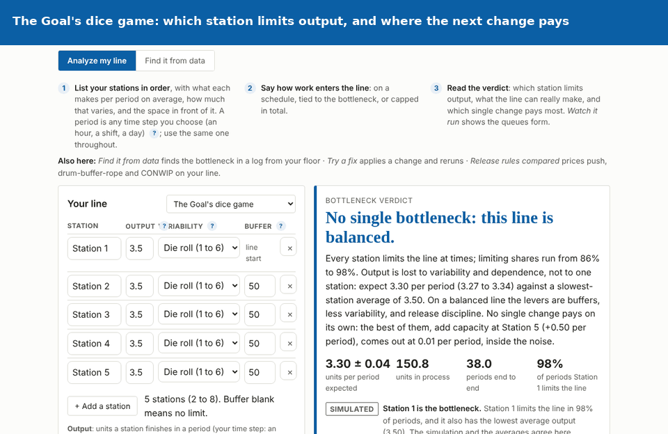
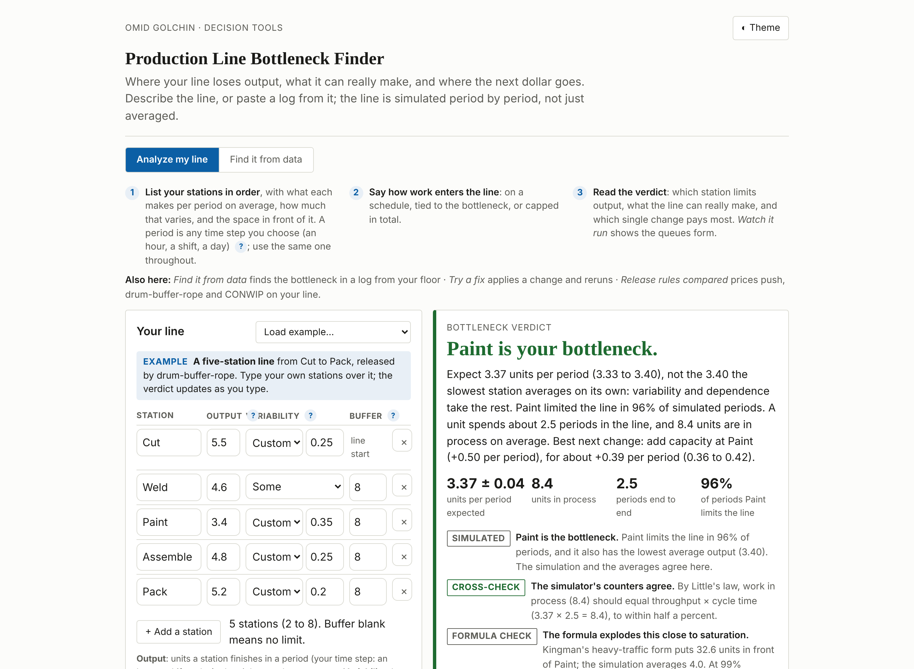
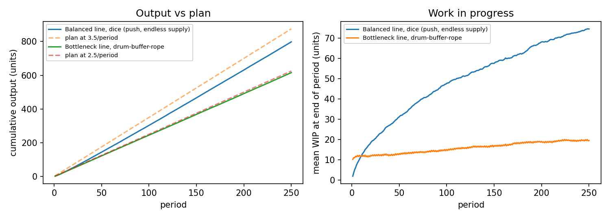

# Production Line Bottleneck Finder

For anyone who runs a production line (a job shop, a cell, a small plant): enter your stations with their average output, variability and buffer space, and get the bottleneck, the output the line can really sustain, and a ranked list of the changes that would raise it. Or paste a log of station states and get the bottleneck from the data instead.





**Use it:** https://omidgolchin.github.io/production-line-simulator/ (runs in your browser; nothing you type leaves it)

## What it does

- **Analyze my line.** A station table (average output per period, variability from steady to a die roll, buffer space in front of each station) and a release rule: push on a schedule, drum-buffer-rope (release tied to the bottleneck), or CONWIP with a cap on work in process. The verdict names the bottleneck, gives expected output with a range, and says where the next dollar goes.
- **Watch it run.** The same line animates period by period, with work visibly piling into the buffers. Buttons add capacity or buffer at any station and restart the line with the fix in place.
- **Ranked changes.** Every single change (more capacity at each station, more buffer where space is finite) is priced by paired simulation runs against the current line, best first, each with a 95% range.
- **Find it from data.** Paste or upload a log, one row per period and one column per station, cells either states (busy, starved, blocked, down) or units produced. The active-period method reads the bottleneck out of it, and the averages can be carried back into the first mode.
- **Fill from my description.** Describe the line in plain words, or paste a shift report; a language model (your key, or copy the prompt into any assistant) fills the form, quoting the phrase each number came from. The model never computes the answer.
- **Copy summary / Copy link.** The link carries the inputs, so a line can be shared and reopened exactly.
- **Help where you need it.** Each mode opens with three steps saying what to enter and what you get; every input has a line under it saying what the number is, why it matters and where to find it; and every technical term in the inputs and results has a **?** that opens a plain-language explanation.

## Built-in checks

| Check | What it does |
|---|---|
| The bottleneck (by simulation) | Scores every period by which station's own capacity was the binding limit, so the verdict follows the simulation, not the averages. When the two disagree, the panel says so. |
| The simulator's counters agree | Little's law: work in process must equal throughput times cycle time. The check compares the simulator's own counters and reports a line that never settles instead of hiding it. |
| Formula next to simulation | Kingman's heavy-traffic approximation of the queue in front of the bottleneck, printed next to the simulated queue, with the size and direction of its error on this line, and a warning when utilization is so high the formula explodes. |
| Release rules at the same output | The same line under push, drum-buffer-rope and CONWIP, each set to make 95% of what the line can pass: the work in process each needs, and what happens when its setting is 20% too high (push's queues grow all run; a pull rule holds a few more units). |
| The plan is met / not met | If you state a planned output, expected output is checked against it and the best change is priced against the gap. |
| Longest unbroken run wins (data mode) | The active-period method: the station active longest without a break is the momentary bottleneck (Roser, Nakano & Tanaka 2001). Averages are shown next to it, and the panel flags it when they point at a different station. A log with no idle time in it is called out as unreadable rather than guessed at. |

## Design decisions

- **Simulation first, averages second.** A station's limiting share (the fraction of periods its own capacity draw was the binding limit, with work waiting and room behind it) decides the verdict. The station with the lowest average is often the bottleneck, but not always, and the gap between the top two shares decides between a clear verdict, a wandering bottleneck, and a balanced line.
- **A full buffer is a symptom before it is a diagnosis.** Stations upstream of a capacity bottleneck are blocked whenever its buffer fills, so a high blocked share alone does not make a buffer verdict. The verdict calls the buffer the bottleneck only when the priced options agree: the single best change is more space in front of that station.
- **Kingman's formula, with its territory marked.** The heavy-traffic form queue ≈ (arrival variance + capacity variance) / (2 × (capacity − throughput)), with arrival variability propagated by Whitt's departure rule. In this batch-period model it overpredicts the simulated queue by a factor of 1.3 to 2.0 at utilizations of 0.85 to 0.95, and its denominator collapses as utilization approaches 100%, where it explodes. The tool shows it as a cross-check and says which case the line is in.
- **Drum-buffer-rope is a rope, not a release rate.** Work waiting at or before the bottleneck is held at the rope length, so a unit enters only when the bottleneck takes one (Goldratt & Cox, 1984). An earlier version released at the bottleneck's mean pace, which loads the bottleneck at 100% and lets its queue drift upward all run; on the default line the true rope holds 8 units in process instead of 20 at the same output.
- **Release rules are compared at the same output, and with a wrong setting.** Each rule is set to make 95% of what the line passes when fed without limit: push at exactly that rate (the smoothest push there is), the rope and the CONWIP cap at the smallest values that reach it. A smooth push at the right rate is competitive; the difference shows when the setting is 20% off, where push's work in process on the default line goes from about 8 to about 95 and the pull rules' from 5–6 to 6–8 (Hopp & Spearman, *Factory Physics*).
- **One engine, two implementations.** The browser engine (docs/linesim.js) is a line-by-line mirror of the Python reference (src/linesim/), including the same congruential random numbers and the same rounding (capacity draws round half-to-even, as Python's round does). They agree exactly on die, uniform and fixed capacities; normal capacities are excluded from exact agreement because the platforms' math libraries differ in the last bits, and are covered by statistical checks instead.
- **The period is a modeling choice.** Within a period, work flows into a buffer before the station behind it drains, so a period's flow through a buffer cannot exceed the buffer's size. Lines whose buffers hold only a few units belong on a short period (an hour, a shift), which is also where the tool's examples live.
- **The AI assist only fills the form.** It works from the visitor's own key (or a copied prompt), returns strict JSON, shows the source phrase for every value, lists what was not stated, and applies nothing until the visitor confirms. It never sees the results and never computes one.

## Validation

- **47 tests** (`make test`, Python 3.12 and Node): a deterministic line's throughput equals its minimum capacity under every release rule; Little's law within 1% on three simulated lines (exact on the fixed-capacity line); the Kingman approximation within its stated factor (measured 1.32×, 1.95× and 1.45×) on three settings; the active-period method finding the planted bottleneck in a constructed log; the rope holding work in process constant on a fixed line and bounded on a variable one; the release comparison reaching its target output with every rule, and push's work in process exploding when its rate is 20% too high while CONWIP's barely moves; every verdict state reached by a constructed case; the assist's prompt, reply parsing and quote checks.
- **JavaScript against Python.** The two engines agree exactly on five recorded simulation cases, and the analysis layers agree on three full line analyses, three logs and fourteen verdict cases (tests/fixtures/).
- **The studies behind it** reproduce the dice game's loss (a balanced line of die stations delivers 3.27 per period against a 3.5 average) and Little's law within 0.5% on the settled lines ([results/summary.md](results/summary.md)).
- **AI extraction: not yet run.** The 20-item test set (assist/testset.json: per-shift rates that need a stated shift length, batch processes, cycle times instead of rates, ranges, a station that is down, text with no numbers) is scored by scripts/eval_assist.js with the visitor's own key; no score is claimed until it has been run.
- Checked in a headless browser at 1366px and 390px widths: no console errors, no sideways scroll, every example loads, and every verdict state is reachable from the examples.

## What I learned

- The bottleneck is a share, not a station you point at once. On variable lines the constraint is a distribution over periods, and two stations can split it closely enough that fixing one alone just hands the problem to the other.
- My first buffer rule fired on perfectly ordinary lines: queues back up from a real bottleneck through every buffer in front of it, so "the upstream station is blocked" is evidence about the bottleneck, not about the buffer. The verdict had to wait for the priced options to agree before calling space the problem.
- An approximation has a territory, and the tool has to mark the border. Kingman's formula is a useful cross-check at 90% utilization and nonsense at 99.5%, and both facts belong on the page next to its number.
- A balanced line loses real output to dependence alone. Five die stations averaging 3.5 deliver 3.27, and no single fix recovers it, because there is no single culprit; the remedies are buffers, variability and release discipline, in that order.
- A release rule's real job is surviving a wrong setting. Set to the right output, a smooth push holds about as little work in process as the pull rules; set 20% high, its queues grow without bound while drum-buffer-rope and CONWIP add a unit or two. I first built "drum-buffer-rope" as a release rate equal to the bottleneck's pace, which is that same fragile push in disguise.

## Research notes

The studies behind the tool, kept out of it on purpose. Full numbers in [results/summary.md](results/summary.md); configurations, ground truth and logs under results/ and outputs/.

- **Balance and variability.** A line of fixed-capacity stations delivers exactly its rate (4.00 per period). The same line rolling dice (mean 3.5) delivers 3.27 [3.24, 3.30]: the loss is dependence plus variability, not a bottleneck. 
- **Buffers.** On a dice line, buffer caps of 10, 4 and 2 in front of each station cut throughput to 2.96, 2.23 and 1.55. Work in process falls as the caps shrink, but output falls faster: small buffers starve the line they were meant to tidy.
- **Where capacity pays.** Adding 1 to the bottleneck's capacity raises throughput by 0.80 [0.77, 0.83]. Adding it at the first station raises throughput by 0.00 and piles 149.56 more units into the line. The ranked list in the tool is this experiment, run on the visitor's own line.
- **Release rules.** (In this frozen experiment "drum-buffer-rope" releases at the bottleneck's mean pace, the earlier implementation; the tool now uses a true rope, and the experiment reproduces byte for byte.) At the same bottleneck line, push and drum-buffer-rope deliver the same throughput (2.49 vs 2.47) with work in process of 384.24 vs 19.38 and cycle times of 77.22 vs 7.76 periods. Under push the queues grow all run long, and Little's ratio (2.00) says so; under drum-buffer-rope it is 1.01.
- **Can a language model find the bottleneck?** Twelve line configurations, three open models, three ways of asking (answer directly, write a simulation, read a process log), scored against 1,000-replication ground truth. Reading the configuration, all three models named the bottleneck in 12 of 12. Writing code separated them (MiniMax-M3.1-Flash 12 of 12, gpt-oss-120b 9, GLM-5.3-Flash 4), and reading logs separated them differently (9, 6 and 8 of 12). Total cost of the check: $0.714. A small check, not a ranking.

## Run it

```bash
python3 -m venv .venv && .venv/bin/pip install -r requirements.txt
make test        # all tests, including the JavaScript engine (needs node)
cd docs && python3 -m http.server 8000   # the tool at http://localhost:8000
```

## Layout

- `docs/`: the tool (plain HTML and JavaScript, no build step). `linesim.js` is the simulation and analysis engine; `tool-common.js` and `tool.css` are the shared tool kit; `assist-config.js` is the AI assist's prompt.
- `src/linesim/`: the Python reference: `simulate.py` (the engine), `finder.py` (the analysis layer the page mirrors), and the research machinery (`experiments.py`, `groundtruth.py`, `llm.py`, `score.py`) behind the research notes.
- `assist/` and `scripts/eval_assist.js`: the assist's 20-item test set and its scorer.
- `results/`: the studies' summary, figures and logs. `PLAN.md`, `FREEZE_MANIFEST.txt`, `DECISIONS.md`, `SPEND.md`: the frozen plan for the studies, its hashes, every judgment call, and what the model calls cost.

## Limitations

- One serial line, one product, stations in a fixed order. No parallel machines, rework loops, or routing choices.
- Variability is a single coefficient per station (or a die roll). Breakdowns, setups and batching enter only through the average rate and its variability; a batch process is described by its average rate per period.
- Discrete periods: within a period, units flow into a buffer before the station behind it works, so a period's flow through a buffer cannot exceed the buffer's size. Pick a period your buffers make sense in.
- The Kingman numbers are a cross-check inside their territory (see Design decisions), never the headline.
- Data mode needs idle time in the log. An output log in which every station produced something in every period cannot be separated, and the tool says so.

## References

1. Goldratt, E. M., & Cox, J. (1984). *The Goal: A Process of Ongoing Improvement*. North River Press.
2. Little, J. D. C. (1961). "A Proof for the Queuing Formula: L = λW." *Operations Research* 9(3), 383–387. https://doi.org/10.1287/opre.9.3.383
3. Kingman, J. F. C. (1961). "The single server queue in heavy traffic." *Mathematical Proceedings of the Cambridge Philosophical Society* 57(4), 902–904.
4. Whitt, W. (1983). "The Queueing Network Analyzer." *Bell System Technical Journal* 62(9), 2779–2815. (The departure variability rule used to carry arrival variability between stations.)
5. Spearman, M. L., Woodruff, D. L., & Hopp, W. J. (1990). "CONWIP: a pull alternative to kanban." *International Journal of Production Research* 28(5), 879–894.
6. Hopp, W. J., & Spearman, M. L. (2011). *Factory Physics* (3rd ed.). Waveland Press.
7. Roser, C., Nakano, M., & Tanaka, M. (2001). The active period method for bottleneck detection. *Proceedings of the Winter Simulation Conference*.

## Citation and license

Omid Golchin. *Production Line Bottleneck Finder* (repository production-line-simulator), 2026. See `CITATION.cff`.
Code: MIT License (`LICENSE`). The process logs in results/logs/ were generated by the simulator in this repository.
